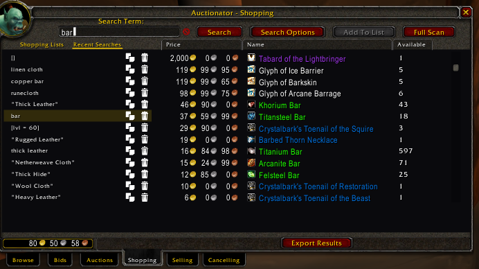
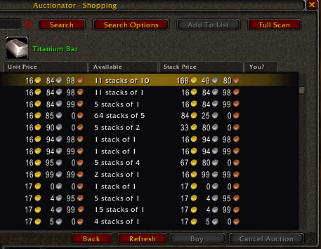
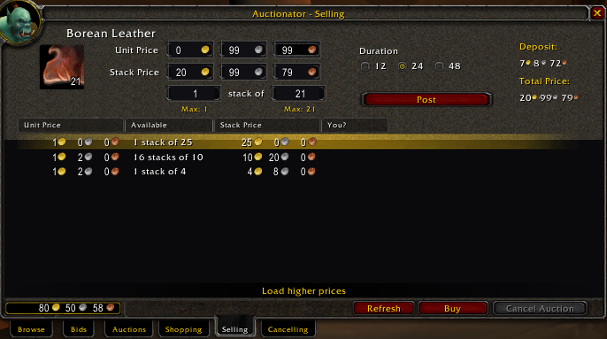
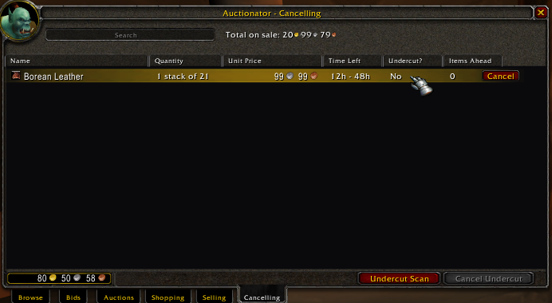

# Auctionator — WoW 3.3.5a (WotLK) backport

> The modern **[Auctionator](https://github.com/TheMouseNest/Auctionator)** auction-house
> addon, backported to run on **stock Wrath of the Lich King 3.3.5a** (interface `30300`,
> client build `12340`) — no ClassicAPI or other compatibility addon required.

Auctionator makes buying, selling and managing auctions fast and painless: live prices in
your tooltips, a powerful search with shopping lists, one-click reposting, and undercut
detection — all wrapped in a clean UI that fits the WotLK auction house.

---

## Screenshots

**Shopping** — shopping lists, recent searches and cheapest-first results:

**Buying** — click a result for the live auctions, then click **Buy Stack** for each
stack. Chain buy selects the next price for your next click:

**Selling** — unit/stack pricing with deposit and total shown, current competition below:

**Cancelling** — your auctions with undercut status and one-click cancel:

**Full Scan** — the whole AH in one `getAll` query (33k auctions in 28 s here):

---

## Installation

1. Download / clone this repository.
2. Copy the **`Auctionator`** folder into your client's `Interface\AddOns\` directory
   (so you end up with `Interface\AddOns\Auctionator\Auctionator.toc`).
3. Restart the game client (a full restart — `/reload` is unreliable on 3.3.5a).
4. Open any auctioneer; the Auctionator tabs appear along the bottom of the AH window.

Saved data (shopping lists, price database, recent searches, etc.) lives in `WTF\` and
survives updates.

---

## Features

### Tooltips & pricing
- **Auction price in item tooltips** — current AH value and a disenchant estimate.
- **Full Scan** — refreshes the price database for the entire auction house. Uses the
  bulk **`getAll`** query when the server allows it (the whole AH in **one** response —
  tens of thousands of auctions in seconds) and falls back to a fast page-by-page scan
  otherwise, with a phase-aware live progress panel (waiting / reading / processing /
  page progress with speed and ETA) and a cancel button.

### Shopping
- **Search with rich filters** — name, exact match, item class, level/item-level ranges,
  price range, quality, and quantity via the **Search Options** dialog.
- **Shopping lists** — save groups of searches; import/export lists as text.
- **Recent searches** — every search is remembered and one click re-runs it.
- **Available count** shown per result (a `N+` lower bound while a multi-page search is still
  loading, exact once all pages are fetched).

### Buying
- Click a result to open the buy view with the live auctions, item icon and tooltip.
- **Buy Stack** — buy one stack per click, with a live item, quantity and price check.
- **Chain buy** selects the next-cheapest price (with a price-jump warning); buying
  still requires another click. Automatic Buy All is unavailable because some 3.3.5a
  clients require a hardware click for every bid.

### Selling
- Place an item in the sell slot and post with unit/stack pricing and a duration choice;
  the slot icon shows the **stack count**, and **Deposit / Total Price** are shown clearly.
- Protection against accidentally posting far below value.

### Cancelling
- Lists your active auctions with time left and an **Undercut Scan** to flag undercut
  auctions, plus **Cancel Undercut** for quick cleanup.

---

## What's different in this backport

The retail UI framework Auctionator is built on does **not** exist on 3.3.5a, so it is
reimplemented in a self-contained compatibility layer under **`WotLKCompat/`** (loaded
first): the `ScrollBox` system, `mixin=`/`<OnX method>` XML, the `C_*` namespaces, `Enum`,
frame pools, `C_Timer`, the menu/dropdown system, `Mixin`/`CreateFromMixins`, and the
templates Auctionator expects. Only the **Legacy auction-house** path (the classic
`QueryAuctionItems` API) is kept — the retail / Cataclysm / Classic-Era / `C_AuctionHouse`
paths were removed.

On top of the port, this fork includes a number of 3.3.5a-specific fixes and quality-of-life
additions, among them:

- Stack-count overlay on the Selling slot icon.
- Solid, readable dialogs (Search Options, Price History, Full Scan, Import/Export) — the
  retail backgrounds render transparent/green on this client.
- Full-width dark result panels and a tidied Shopping header (centered *Search Term*,
  active-tab marker, no texture bleeds).
- Buying/cancelling completion driven by reliable 3.3.5a signals (gold change, owned-list
  change) instead of events that don't fire on this client.
- A heavily optimized Full Scan: a **`getAll` engine** that fetches the whole AH in one
  query and reads/merges 100k+ rows in per-frame time-budgeted chunks (no client freeze),
  with automatic fallback to an optimized page-by-page engine — frame-paced polling, no
  end-of-scan freeze, and a stale-page recovery that *polls the local result list* instead
  of re-querying, so a busy realm scans at the server's natural page rate.

A deep technical write-up of the compatibility layer, the API/index differences, and the
offline XML-transform tooling lives in **[BACKPORT_NOTES.md](BACKPORT_NOTES.md)**.

---

## Known limitations

- **`getAll` availability is up to the server.** The bulk `getAll` query has a **15-minute
  cooldown** enforced by the server, and some cores disable it or — worse — **silently drop**
  the request instead of answering with an error (the client-side availability flag resets on
  every relog, so it can't be trusted). Auctionator handles all of this automatically: an
  unanswered `getAll` is remembered per realm for 24 hours and scans go page-by-page there
  (`/atr getallretry` re-enables it early, e.g. after a server restart), and a `getAll` that
  answers again clears the flag by itself. One quirk cannot be worked around: on cores that
  drop `getAll`, the unanswered request **locks the AH query gate** — the addon detects this,
  aborts cleanly and tells you to close and reopen the auction house.
- **Page-scan speed is server-bound.** When `getAll` isn't available, pages can't be
  pipelined: a Full Scan is paced by how fast the server answers one ~50-item page at a time
  (the client also enforces a ~0.3s minimum between queries, so ~150–165 auctions/s is the
  hard ceiling). The engine sends the next page the instant one lands and never re-queries a
  page just because the update event arrived a beat early, so it runs at that natural ceiling
  on busy and quiet realms alike — but a slow or heavily loaded server is still the floor.
- **Huge `getAll` responses are the server's call.** Streaming a very large AH (100k+
  auctions) in one response has historically disconnected clients on some cores. If that
  happens on your server, enable the *alternate scan mode* in **Advanced options** to force
  page-by-page scanning.
- **Custom servers vary.** Some private servers don't fire the standard auction-house
  confirmation events (post / buyout / cancel), so a few flows rely on fallback signals and
  behaviour can differ slightly between servers.

---

## Credits

- Original **Auctionator** by **plusmouse** and **Borjamacare** —
  [TheMouseNest/Auctionator](https://github.com/TheMouseNest/Auctionator).
- WoW 3.3.5a (WotLK) backport by **Jedborg**
  ([JedborgWoW](https://github.com/JedborgWoW)).

Licensed **All Rights Reserved** (© 2020–2025 plusmouse, borjamacare; backport
modifications © 2026 Jedborg) — see [LICENSE](LICENSE). Consider supporting the
original authors on [Patreon](https://patreon.com/auctionator).
